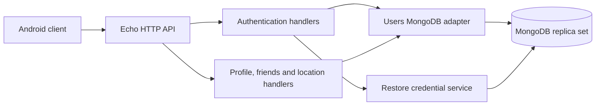

# Project architecture review

Reviewed on 2026-10-19.

Overall, this is a sensible architecture for a small location-sharing service. **I would preserve its core design.** The strongest choices address real problems: concurrent updates, session revocation, privacy, and limited server resources. The main improvements are specific correctness fixes and operational cleanup.

The project is a **modular monolith**: one API process, with packages separating responsibilities.

| Part | Responsibility |
|---|---|
| [`cmd/server`](../cmd/server/main.go#L50) | Loads configuration, constructs dependencies, verifies indexes, starts HTTP. |
| `internal/webapi` | Routing, authentication middleware, request limits, binding, validation, public errors. |
| `internal/users` | User models, MongoDB reads/writes, session replacement, friendship consistency. |
| [`internal/restore`](../internal/restore/service.go#L37) | Android credential restoration, challenge verification, credential persistence. |
| `internal/config`, `internal/mongo` | Configuration validation and database connection setup. |
| `pkg` | Supporting code for JWTs, password hashing, identifiers, clocks, and logging. |
| `cmd/cli` | Administrative entry point for configuration generation and index creation. |

A user document contains authentication state, the latest location, status, accepted friends, friendship dates, and sharing pauses. Pending requests live separately. Restore credentials and challenges also have separate collections.

This fits the current product: clients upload their latest position and retrieve friend snapshots. There is no location-history pipeline or background processing system to operate.

These are the solutions I would keep:

| Solution | Why it should stay |
|---|---|
| **Explicit dependency construction** | Dependencies are assembled visibly in `main`. Injected clocks and interfaces make behavior testable without a dependency-injection framework. |
| **JWT validation plus persisted session checks** | JWT signatures establish authenticity; MongoDB checks establish whether the session is still accepted. This deliberately trades a database read for prompt revocation. It is a stateful session design. |
| **Atomic refresh rotation** | [`ReplaceTokens`](../internal/users/auth.go#L147) matches the previously read credentials before replacing them. Concurrent refreshes cannot both consume the same credential. Refresh digests and distinct token purposes are also good protections. |
| **Transactional friendship changes** | [`relationshipTransaction`](../internal/users/relationships.go#L25) updates both accounts together and makes competing mutations conflict. This protects symmetry and capacity limits across multiple API instances. |
| **Timestamp-ordered location updates** | [`UpdateLocation`](../internal/users/location.go#L45) compares timestamps inside the database update. A delayed mobile request cannot overwrite a newer position. Keep this atomic guard. |
| **Bounded pages and focused projections** | Friend pages contain at most 50 entries. Pending lists fetch identity fields, and accepted lists compute location visibility in MongoDB. This limits response size, avoids queries per friend, and reduces unnecessary sensitive-data reads. |
| **Separate limits for database and password work** | Database admission, connection-pool limits, and bcrypt admission protect different resources. Immediate rejection prevents an accumulating application queue. The defaults still need measurement on deployment hardware. |
| **Separate restore-credential service** | Challenges are short-lived, bound to their purpose, and consumed atomically. Keeping system-managed restore keys separate from user-managed passkeys follows [Android’s guidance](https://developer.android.com/identity/sign-in/restore-credentials-implementation). |

The database-side safeguards are particularly valuable. An application mutex would protect only one process; the current atomic operations and transactions also work when requests reach different replicas.

I would prioritize improvements as follows:

1. **Fix sharing pauses for newly created accounts.**

   Signup leaves `PausedUsers` nil, which is stored as BSON `null`. `StopSharing` then applies `$addToSet`, which rejects a null field. I reproduced this against MongoDB.

   Initialize the array when creating users and make updates tolerate existing null records. Add a regression covering signup, friendship acceptance, and pausing. The relevant code is in [signup](../internal/webapi/auth/mux.go#L220) and [StopSharing](../internal/users/user.go#L276).

2. **Validate all location measurements.**

   Timestamp validation is thorough, but coordinates and measurements lack equivalent checks. I confirmed that latitude/longitude `999`, negative speed and accuracy, and bearing `999` return 204 and reach persistence. Missing coordinates also become zero.

   Use a separate upload type that distinguishes missing coordinates from valid zero values. Validate latitude within ±90, longitude within ±180, bearing within `[0,360)`, and nonnegative speed/accuracy. Preserve the useful distinction between unavailable measurements and measured zero. See [location types](../internal/webapi/me/types.go#L89).

3. **Bound sharing-pause growth.**

   Once the null-field issue is removed, an account can pause arbitrary existing users without friendship membership or capacity checks. I reproduced 2,049 paused users on an account with zero accepted friends. `/me/sharing` returns the whole list.

   Restrict pauses to accepted friends if that is the intended product behavior, enforce the restriction atomically, and provide bounded reads for existing oversized lists. The current [sharing-list implementation](../internal/users/list_reads.go#L56) needs this boundary.

4. **Run MongoDB regression tests in CI.**

   The tests are useful, but the [CI workflow](../.github/workflows/go.yml#L19) supplies no MongoDB instance or `MONGO_TEST_URI`. Consequently, important persistence and concurrency tests skip.

   Add a job that starts and initializes a temporary replica set, sets the URI, and runs the suite with `-race`. Ensure that job fails when database setup fails.

5. **Add graceful shutdown and database readiness.**

   [`main`](../cmd/server/main.go#L140) has HTTP timeouts but no signal-driven shutdown. Add a bounded shutdown period that drains requests before disconnecting MongoDB; Go provides [`Server.Shutdown`](https://pkg.go.dev/net/http#Server.Shutdown).

   Keep the lightweight health endpoint as liveness, and add a separate readiness check for database availability.

6. **Make proxy-aware rate-limit policy explicit.**

   The limiter safely ignores untrusted forwarding headers. Behind one reverse-proxy peer, however, clients share its source quota—including five signups per hour.

   Either configure verified client-IP extraction consistently or treat peer quotas as aggregate limits and enforce client quotas at the gateway. Preserve the protection against spoofed headers. [Echo documents the required trust model](https://echo.labstack.com/next/guide/ip-address/).

7. **Refine package boundaries incrementally.**

   Authentication handlers currently coordinate password checks, device policy, token generation, and persistence. Extract that orchestration into a focused service as it evolves, following the existing restore-service pattern. Smaller consumer interfaces would also simplify tests.

   Standardize authentication errors through the existing JSON envelope while preserving client-dependent status semantics. Some middleware errors currently return plain text.

There are also straightforward maintenance fixes: pin the Compose MongoDB image instead of `latest`, correct the README’s conflicting MongoDB requirements—the application requires MongoDB 6+ with transactions—and share index initialization between server and CLI. The CLI currently omits restore indexes.

**Validation:** At review time, build, vet, and a fresh full test run with the race detector passed against a temporary MongoDB replica set. Additional isolated probes exposed the issues above. The review did not change application source code. The live Cloudflare/Hetzner protection recheck remains incomplete.
